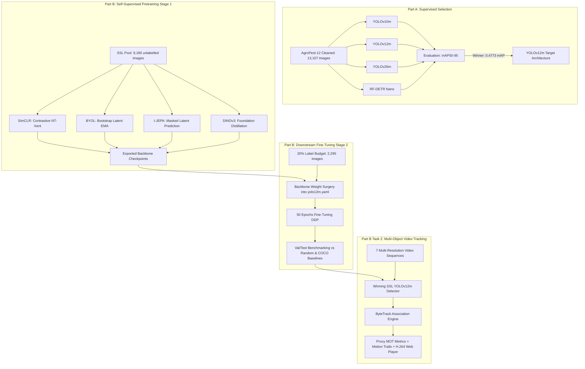

# AgroPest-12: Self-Supervised Pretraining, Label-Efficient Object Detection & Multi-Object Tracking

[](https://www.python.org/)
[](https://pytorch.org/)
[](https://docs.ultralytics.com/)
[](https://www.kaggle.com/)
[](LICENSE)

**Course:** CSE 445 — Computer Vision  
**Institution:** Department of Computer Science and Engineering, East West University, Dhaka, Bangladesh  
**Instructor:** Dr. Mohammad Rifat Ahmmad Rashid  
**Author:** Md. Sadik Shahriar (Student ID: 2023-2-60-103)  

---

## 📌 Project Overview

This repository contains the complete two-part research implementation for **AgroPest-12 Crop Pest Detection and Tracking**:

1. **Part A (Fully Supervised Object Detection):** Comprehensive benchmarking of 4 state-of-the-art detectors (**YOLOv10m**, **YOLOv12m**, **YOLOv26m**, and **RF-DETR Nano**) across 13,107 cleaned images spanning 12 agricultural pest classes. **YOLOv12m** emerged as the winning architecture with a test $\text{mAP}_{50-95}$ of **0.4773** and test $\text{mAP}_{50}$ of **0.8102**.
2. **Part B (Self-Supervised Pretraining & Label-Efficient Downstream Detection):** Investigates whether self-supervised pretraining (**SimCLR**, **BYOL**, **I-JEPA**, and **DINOv3 Distillation**) on unlabelled agricultural imagery can match fully supervised performance when fine-tuned on only **20% labelled data** ($\rho = 0.20$).
3. **Part B Task 2 (Multi-Object Video Tracking):** Deploys the winning YOLOv12m detector in a multi-object tracking pipeline (**ByteTrack**) to track agricultural pests across 7 diverse video sequences with mixed resolutions (1080p, 720p) and orientations (landscape 16:9, portrait 9:16).

---

## 🔬 Core Research Question

> *"If we pretrain a detector backbone with self-supervised learning (SSL) on unlabelled domain imagery, how much of the expensive bounding-box annotation budget can we save while retaining detection performance — and does the resulting detector remain strong enough to drive downstream multi-object tracking on real and synthetic video?"*



---

## 📊 Dataset: AgroPest-12 & Leakage-Safe Partition

The dataset contains **12 pest classes**: `Ants (0)`, `Bees (1)`, `Beetles (2)`, `Caterpillars (3)`, `Earthworms (4)`, `Earwigs (5)`, `Grasshoppers (6)`, `Moths (7)`, `Slugs (8)`, `Snails (9)`, `Wasps (10)`, `Weevils (11)`.

### 1. Data Cleaning (Part A)
Exploratory data analysis identified **36 corrupt Roboflow export label errors** where image contents conflicted with annotations. Cleaning produced **13,107 clean images** (11,475 train, 1,089 valid, 543 test).

### 2. Triplet-Aware Augmentation-Family Leakage Prevention (Part B)
Because the training split contains alphabetically consecutive triplets (1 source image + 2 augmented variants), standard random splitting would cause **augmentation-family leakage** across partitions. We constructed `AgroPest-12-PartB-Safe`:

| Partition | Path | Images | % of Total | Purpose |
|---|---|---:|---:|---|
| **SSL Pool** | `ssl_pool/images/` | **9,180** | 70.04% | Self-supervised pretraining only (labels discarded) |
| **Fine-tuning Set** | `finetune_20/images/`, `labels/` | **2,295** | 17.51% | $\rho = 0.20$ labelled downstream fine-tuning |
| **Validation Split** | `valid/images/`, `labels/` | **1,089** | 8.31% | Early stopping & model selection |
| **Test Holdout** | `test/images/`, `labels/` | **543** | 4.14% | Unchanged final evaluation reference |

- **Kaggle Dataset:** [`sadikshahriar/agropest-12-partb-safe`](https://www.kaggle.com/datasets/sadikshahriar/agropest-12-partb-safe/)

---

## 🏆 Part A: Supervised Benchmark Results

All models were trained for 50 epochs on 2x Tesla T4 GPUs with mixed precision (AMP) and identical hyperparameters.

| Model Architecture | Precision | Recall | $\text{mAP}_{50}$ | $\text{mAP}_{50-95}$ | F1-Score | Parameters | Inference / Img |
|---|---|---|---|---|---|---|---|
| **YOLOv12m** 🥇 | **0.866** | **0.756** | **0.8102** | **0.4773** | **0.801** | 20.1M | 35.2 ms |
| **YOLOv10m** 🥈 | 0.819 | 0.737 | 0.7908 | 0.4730 | 0.772 | **15.3M** | **23.7 ms** |
| **YOLOv26m** 🥉 | 0.850 | 0.731 | 0.7867 | 0.4750 | 0.779 | 20.4M | 30.6 ms |
| **RF-DETR Nano** | 0.437 | 0.693 | 0.5705 | 0.3620 | 0.532 | — | — |

> **Selection Verdict:** **YOLOv12m** won on **8 of 12 classes**, achieved the highest $\text{mAP}_{50-95}$ ($0.4773$), highest precision ($0.866$), and best generalization ($\text{Test mAP} > \text{Val mAP}$). It was selected as the target downstream architecture for all Part B experiments.

---

## 🧬 Part B: Self-Supervised Learning (SSL) Implementations

The course uses a **standalone, self-contained PyTorch DDP implementation** (no external framework dependencies).

| Method | Family | Objective & Mechanism | Backbone Integration Strategy |
|---|---|---|---|
| **SimCLR** | Contrastive | NT-Xent loss across two strongly augmented views; in-batch negatives. | Native YAML backbone wrapper with projection MLP; encoder transfer. |
| **BYOL** | Self-Distillation | Online network predicts target network representation; EMA update ($\tau = 0.996$); negative-free. | Dual online/target YOLO backbones with predictor head; encoder transfer. |
| **I-JEPA** | Latent Prediction | Masked context & target patch prediction in latent representation space. | ViT latent prediction with CNN distillation mapping. |
| **DINOv3** | Foundation Distillation | Pretrained DINOv3 ViT-B/16 teacher distilling global class tokens and dense patch tokens into student. | Direct distillation into YOLOv12m student CNN backbone at 224 px. |

### Downstream Weight Surgery Protocol
Each SSL pretraining notebook exports `backbone_only.pt`. The downstream notebook instantiates `yolo12m.yaml` (random weights) and performs weight surgery:
1. Copies the **402 backbone tensors** (Modules 0..8) from the SSL checkpoint.
2. Leaves detection neck (Modules 9..20) and head (Module 21) freshly initialized.
3. Prints a mandatory layer-by-layer mapping report verifying 100% parameter coverage.

---

## 🎯 Part B Task 2: Multi-Object Video Tracking

The downstream tracking pipeline in [`code/partb-05-tracking.ipynb`](code/partb-05-tracking.ipynb) evaluates the trained detector on dynamic video footage.

### Key Tracking Features
- **ByteTrack Two-Stage Matching:** First associates high-confidence detections ($\ge 0.25$), then recovers low-confidence detections ($0.10 \le \text{Conf} < 0.25$) to bridge leaf occlusions and motion blur without identity swaps.
- **Adaptive Multi-Scale Resolution:** Uses `imgsz = 960` for high-resolution/1080p clips and `imgsz = 640` for standard 720p clips.
- **Motion Trajectory Trails:** Renders fading centroid polylines tracing pest movement over the last 30 frames.
- **Glassmorphic Telemetry HUD:** Displays real-time active tracks, cumulative unique IDs, ID-switch proxy events, instantaneous FPS on T4, and per-class breakdowns.
- **Web-Standard H.264 Transcoding:** Transcodes raw outputs with `ffmpeg` (`libx264`, `yuv420p`, `+faststart`) enabling native HTML5 playback in Kaggle.

---

## 📂 Repository Layout

```text
├── AGENTS.md                                # Workspace rules & prompt execution guidelines
├── README.md                                # Project master documentation
│
├── docs/                                    # Technical reports, evaluation logs & setup links
│   ├── evaluation.md                        # Comprehensive Part A evaluation benchmark tables
│   ├── detection.txt                        # Per-class detection & test correctness logs
│   ├── logs.txt                             # Kaggle input paths for trained YOLOv12 weights
│   ├── links.txt                            # Google Drive link for tracking video archive
│   ├── kaggle links.txt                     # Public Kaggle dataset and notebook links
│   ├── SSL_LIBRARY_BYOL_IJEPA_BUG_REPORT.md # PyTorch DDP standalone architecture report
│   ├── track.md                             # Tracking validation & DDP notes
│   └── llama_hard_retrieval_prompts.md      # Retrieval reference prompts
│
├── code/                                    # All Jupyter Notebooks (Part A & Part B)
│   ├── cleaned-dataset-notebook1-eda.ipynb  # Notebook 1: EDA & 36 label-error data cleaning
│   ├── notebook2-yolov10.ipynb              # Notebook 2: YOLOv10m object detection
│   ├── notebook3-yolov12.ipynb              # Notebook 3: YOLOv12m object detection (Part A Winner)
│   ├── notebook4-yolov26.ipynb              # Notebook 4: YOLOv26m object detection
│   ├── notebook 5/                          # RF-DETR Nano stage 1, stage 2 & evaluation
│   ├── partb-dataset-preparation.ipynb      # Part B triplet-stratified 80/20 partition builder
│   ├── partb-00-baselines-yolov12-rand20.ipynb # Baseline: Random-init YOLOv12m @ 20% labels
│   ├── partb-00-baselines-yolov12-coco20.ipynb # Baseline: COCO-init YOLOv12m @ 20% labels
│   ├── partb-01a-simclr-pretrain.ipynb      # Task 1: SimCLR SSL pretraining on unlabelled pool
│   ├── partb-01b-simclr-detect.ipynb        # Task 1: SimCLR backbone → YOLOv12m fine-tune @ 20%
│   ├── partb-02a-byol-pretrain.ipynb        # Task 1: BYOL SSL pretraining on unlabelled pool
│   ├── partb-02b-byol-detect.ipynb          # Task 1: BYOL backbone → YOLOv12m fine-tune @ 20%
│   ├── partb-03a-ijepa-pretrain.ipynb       # Task 1: I-JEPA SSL pretraining on unlabelled pool
│   ├── partb-03b-ijepa-detect.ipynb         # Task 1: I-JEPA backbone → YOLOv12m fine-tune @ 20%
│   ├── partb-04a-dinov3-pretrain.ipynb      # Task 1: DINOv3 distillation pretraining
│   ├── partb-04b-dinov3-detect.ipynb        # Task 1: DINOv3 backbone → YOLOv12m fine-tune @ 20%
│   └── partb-05-tracking.ipynb              # Task 2: Multi-Object Video Tracking (YOLOv12m + ByteTrack)
│
├── context/                                 # Course specifications and dataset documentation
│   ├── AgroPest-12_Dataset_Context.md       # Dataset metadata, classes, and class distribution
│   └── Lab Assignment-A.md                  # Part A assignment guidelines
│
├── Assignment B/                            # Part B specifications
│   └── Lab Assignment Part B.md             # Part B assignment guidelines
│
├── Tracking/                                # Local tracking video footage (1.mp4 - 7.mp4)
└── reference/                               # Reference implementations and coding patterns
```

---

## 🚀 Execution Guide (Kaggle Environment)

All notebooks are designed to execute seamlessly on **Kaggle GPU (2x Tesla T4)**.

### 1. Training Setup
1. Attach the clean dataset input: [`sadikshahriar/agropest-12-partb-safe`](https://www.kaggle.com/datasets/sadikshahriar/agropest-12-partb-safe/).
2. Select **GPU T4 x2** accelerator with **Internet Enabled**.
3. Run the notebook top-to-bottom. Checkpoints and telemetry CSVs are written to `/kaggle/working/`.

### 2. Multi-Object Tracking Execution
1. Open [`code/partb-05-tracking.ipynb`](code/partb-05-tracking.ipynb).
2. Attach `notebook3-yolov12` as a Kaggle input (or provide `yolov12_agropest_best.pt`).
3. Run all cells. The notebook automatically downloads the 7 video sequences from Google Drive via `gdown`, tracks pests frame-by-frame, renders fading motion trails, computes proxy MOT metrics, and transcodes the final videos to H.264 for interactive inline playback.

---

## 📑 Viva Voce Defense Key References

- **Tracking-by-Detection:** Decouples spatial localization (detector $\text{mAP}$) from temporal data association (Kalman filter + Hungarian matching).
- **ByteTrack Low-Confidence Recovery:** Associates low-confidence boxes ($0.10 \le \text{Conf} < 0.25$) to maintain tracks through leaf occlusions without triggering ID switches.
- **MOTA vs IDF1:** MOTA penalizes object misses/false alarms; IDF1 measures persistent identity consistency over time.
- **BoT-SORT vs ByteTrack:** BoT-SORT adds camera motion compensation (GMC) and deep ReID appearance embeddings for dynamic camera movement.
- **Domain Shift:** Macro crop training photos vs wide-angle field video dynamics mitigated by multi-scale inference (`imgsz = 960`).

---

## 📜 Citation & License

This project is developed for academic evaluation in **CSE 445: Computer Vision** at East West University. Released under the [MIT License](LICENSE).
